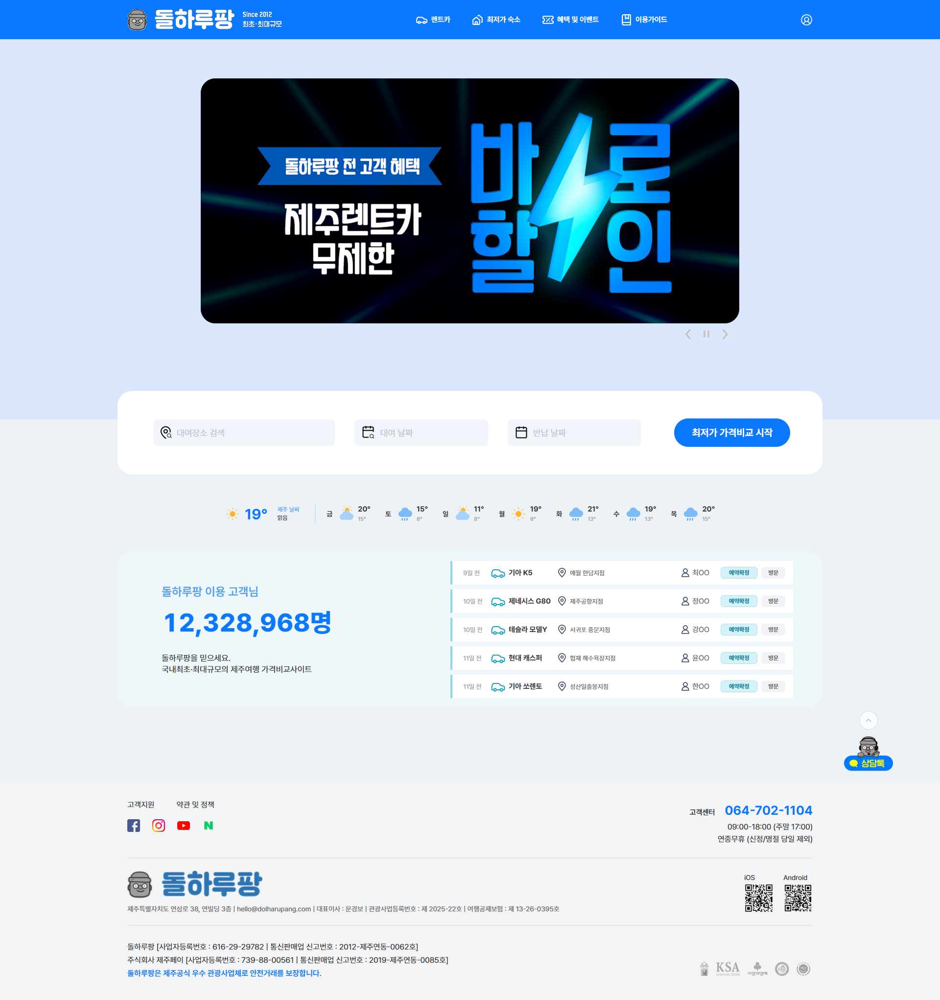
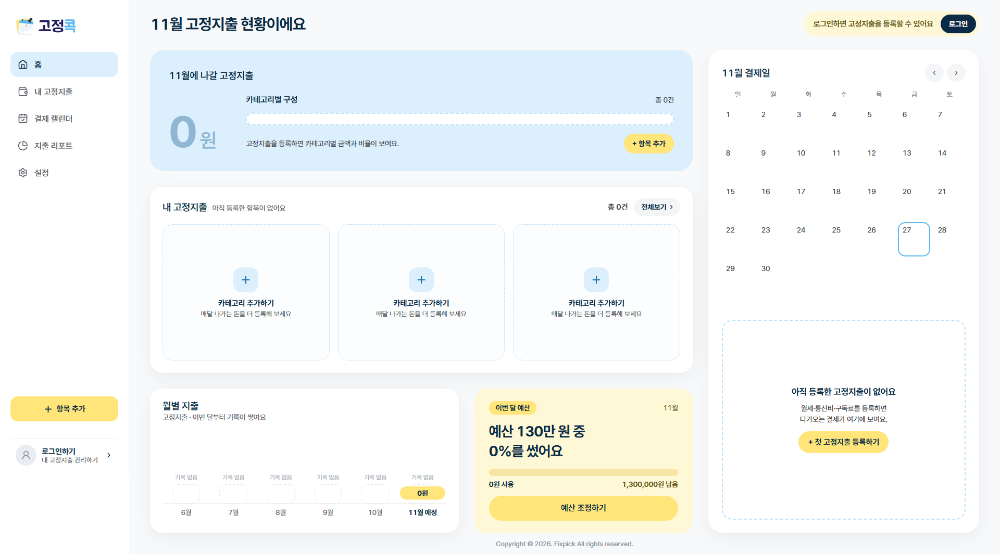

 

 

 

### 사용자 경험을 코드로 구현하는 프론트엔드 개발자

복잡한 서비스를 쉽게 이해하고 사용할 수 있도록  
구조와 인터랙션을 설계합니다.

 

<a href="https://114soyeon.github.io/">PORTFOLIO ↗</a>
&nbsp; · &nbsp;
<a href="mailto:j.2lly.k@gmail.com">EMAIL ↗</a>
&nbsp; · &nbsp;
<a href="https://github.com/114soyeon">GITHUB ↗</a>

  

---

## ✳ About Me

<table>
<tr>
<td width="35%" valign="top">

**HELLO, I'M SOYEON.**

사용자의 입장에서 생각하고  
더 나은 웹 경험을 만드는  
개발자를 지향합니다.

</td>
<td width="65%" valign="top">

안녕하세요, 프론트엔드 개발자 김소연입니다.

웹 퍼블리싱 실무 경험을 바탕으로 사용자 인터페이스와 웹 개발 역량을 넓혀가고 있습니다.

단순히 화면을 구현하는 것에 그치지 않고, 직관적인 UI와 자연스러운 사용자 경험을 만드는 데 관심이 있습니다.

**I believe good development starts with understanding users.**

</td>
</tr>
</table>

 

---

## 🛠 Tech Stack

**FRONTEND**

  

**TOOLS & DESIGN**

 

---

## 🚀 Projects

사용자의 일상에 편리함을 더하는 웹 서비스를 만듭니다.

 

<!-- ===================================== -->
<!-- 01. SWATCHURE : 추후 프로젝트 추가 예정 -->
<!-- 이미지 / 프로젝트 설명 / 기술 스택 / 링크 -->
<!-- ===================================== -->

<table>
<tr>
<th width="18%">PROJECT</th>
<th width="42%">OVERVIEW</th>
<th width="22%">ROLE / STACK</th>
<th width="18%">LINK</th>
</tr>

<tr>
<td align="center">

**01. SWATCHURE**

</td>
<td>

<!-- SWATCHURE 프로젝트 소개를 추후 추가 -->

</td>
<td>

<!-- 역할 및 기술 스택 추후 추가 -->

</td>
<td align="center">

<!-- GitHub / Demo 링크 추후 추가 -->

</td>
</tr>

<tr>
<td align="center">

**02. CARING**

 

</td>
<td>

**Dolharpang Rental Car Website Renewal**

제주 렌터카 서비스 돌하르팡 웹사이트 리뉴얼 프로젝트.

기존 서비스의 UI를 개선하고 사용자가 필요한 정보를 쉽게 찾을 수 있도록 화면을 구성했습니다.

</td>
<td>

Web Publishing

`HTML` `CSS` `JavaScript`

</td>
<td align="center">

<a href="https://github.com/114soyeon">GITHUB ↗</a>

  

<a href="https://114soyeon.github.io/">PORTFOLIO ↗</a>

</td>
</tr>

<tr>
<td align="center">

**03. FIXPICK**

 

</td>
<td>

**Fixed Expense Management Service**

월세, 통신비, 구독료 등 반복되는 고정지출을 한곳에서 관리하는 서비스.

고정지출 현황과 결제 일정을 직관적으로 확인할 수 있도록 대시보드를 구성했습니다.

</td>
<td>

Frontend

`React` `JavaScript`

</td>
<td align="center">

<a href="https://fixpick-beta.vercel.app/">LIVE DEMO ↗</a>

  

<a href="https://github.com/114soyeon">GITHUB ↗</a>

</td>
</tr>

</table>

 

---

## 💼 Experience

실무 프로젝트를 통해 쌓아온 웹 퍼블리싱 경험

 

| COMPANY | WORK |
|:---|:---|
| 중소기업중앙회 | 대고객 시스템 PC / Mobile 웹 퍼블리싱 |
| SC제일은행 | 웹 접근성 개선 퍼블리싱 |
| 현대제철 HCORE STORE | 전자상거래 플랫폼 웹 퍼블리싱 |

 

---

## 📊 GitHub Activity

 

---

## Let's Build Something Better.

더 나은 사용자 경험을 만드는 개발자가 되겠습니다.

 

<a href="mailto:j.2lly.k@gmail.com">
  EMAIL ME ↗
</a>

  

<a href="https://114soyeon.github.io/">PORTFOLIO</a>
&nbsp; · &nbsp;
<a href="https://github.com/114soyeon">GITHUB</a>

  

SOYEON KIM · FRONTEND DEVELOPER · 2026

  

